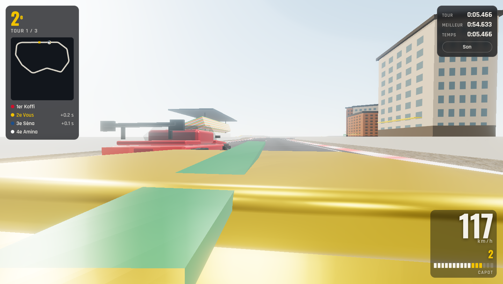
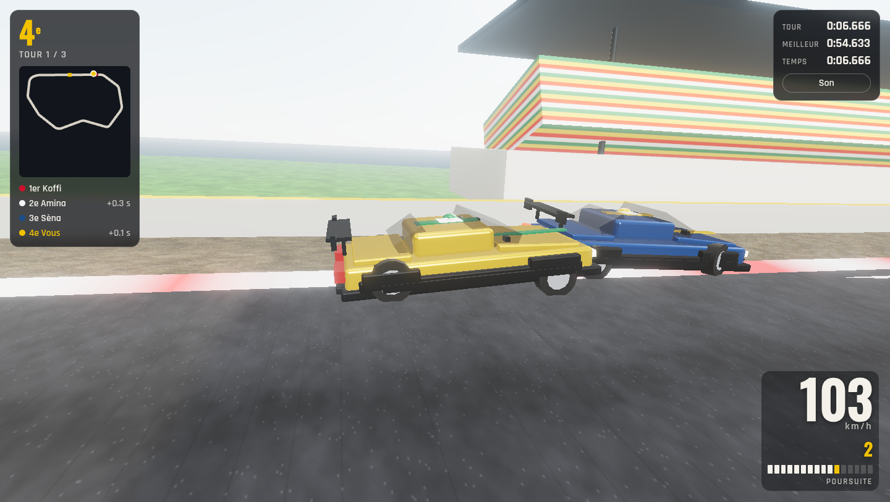

# Circuit Atlantique

Course automobile 3D dans le navigateur. Trois tours sur un circuit urbain fictif du littoral, à Cotonou, contre trois pilotes.







## Lancer en local

```bash
npm install
npm run dev
```

Le jeu est servi sur [http://127.0.0.1:8734](http://127.0.0.1:8734). Le premier clic (Jouer) démarre aussi le son : les navigateurs bloquent l’audio tant qu’il n’y a pas de geste.

Vérifier le build de production :

```bash
npm run build
npm run preview
```

`npm run test:race` rejoue une course complète sans graphique. `npm run check` ajoute un passage Playwright (iPhone 14 et Pixel 7) sur le joystick, les pédales et l’absence de chevauchement avec le HUD.

## Commandes

| Action | Clavier | Écran tactile |
| --- | --- | --- |
| Accélérer | Z, W ou ↑ | Bouton Accélérer |
| Freiner | S ou ↓ | Bouton Freiner |
| Diriger | Q, A, D ou ← → | Boutons Gauche et Droite |
| Reculer | Maintenir frein à l’arrêt | — |
| Frein à main | Espace | Main |
| Caméra poursuite / capot | C | Caméra |
| Replacer sur la piste | R | — |
| Pause | Échap | — |
| Son | M | Bouton Son |

ZQSD et WASD fonctionnent ensemble, pour un clavier AZERTY comme pour un clavier QWERTY. La touche R vous repose après le dernier point de contrôle franchi, sans valider le tour.

## Déployer sur Vercel

Le projet est une application statique Vite. Aucune fonction serveur n’est requise.

1. Poussez le dépôt sur GitHub ou GitLab.
2. Dans Vercel, importez le projet. Le framework **Vite** est détecté : commande `npm run build`, dossier de sortie `dist`.
3. Laissez les variables d’environnement vides. Déployez.

En ligne de commande, depuis ce dossier :

```bash
npx vercel
```

## Licences

- Code du jeu : [MIT](LICENSE).
- [Three.js](https://github.com/mrdoob/three.js) et [postprocessing](https://github.com/pmndrs/postprocessing) : MIT.
- Polices [Rajdhani](https://fonts.google.com/specimen/Rajdhani) et [Orbitron](https://fonts.google.com/specimen/Orbitron), via Fontsource : SIL Open Font License 1.1.
- HDRI **Venice Sunset** (1K), [Poly Haven](https://polyhaven.com/a/venice_sunset) : CC0. Greg Zaal. Sert d’éclairage image (IBL), aligné sur le soleil du ciel.
- Textures PBR 1K, [Poly Haven](https://polyhaven.com) : CC0 — asphalte `asphalt_02` (Rob Tuytel), herbe `leafy_grass` (Charlotte Baglioni), sable `coast_sand_01` (Rob Tuytel), béton `concrete_wall_001` (Dimitrios Savva, traitement Rico Cilliers).
- Voitures : carrosseries procédurales (vernis clair, vitres, jantes). L’éclairage reprend l’approche de Cotonou City : IBL Poly Haven, ciel dégradé, LUT teal/orange.
- Moteur, crissement et bips : synthétisés avec l’API Web Audio, sans fichier audio.
- Palmiers, rails, tribunes et immeubles : géométrie du jeu.

## Graphismes

Heure dorée sur le littoral : ciel HDRI, mer turquoise, asphalte bleu-gris, accents orange et turquoise. Le menu propose trois niveaux : **Bas**, **Moyen** et **Élevé** (ombres, bloom, résolution). Le choix est mémorisé. Sur mobile, bloom et ombres se coupent si l’image passe sous 50 images/s.

## Limites connues

- Les pentes et le dévers restent doux : ce n’est pas un circuit de montagne.
- Le modèle de pneu est une formule simplifiée (angle de dérive, transfert de masse, sous-virage et survirage). Ce n’est pas un Pacejka complet à quatre roues.
- Les palmiers et les immeubles restent procéduraux. La voiture est un modèle glTF partagé, recoloré par pilote.
- Quatre pilotes. Pas de dégâts persistants, de pluie, ni d’arrêts aux stands.
- La fumée de pneu est faite de points, plus lisible en qualité Moyen ou Élevé grâce au bloom.
- L’herbe freine fortement ; un long hors-piste peut faire perdre plusieurs secondes.
- Le meilleur tour et le niveau graphique sont enregistrés dans le navigateur.
