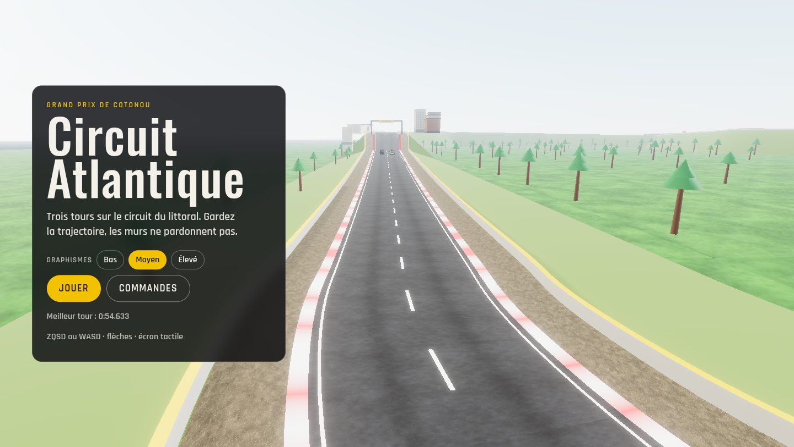
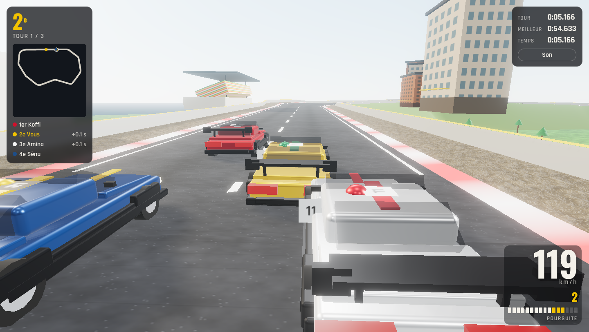
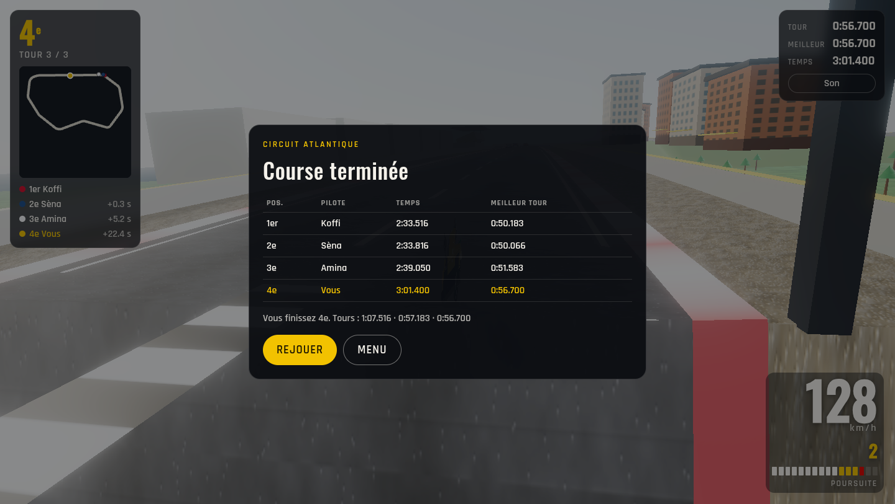

# Circuit Atlantique

Course automobile 3D dans le navigateur. Trois tours sur un circuit urbain fictif du littoral, à Cotonou, contre trois pilotes.








## Lancer en local

```bash
npm install
npm run dev
```

Le jeu est servi sur [http://127.0.0.1:8734](http://127.0.0.1:8734). Le premier clic (Jouer) démarre aussi le son : les navigateurs bloquent l’audio tant qu’il n’y a pas de geste.

Vérifier le build de production :

```bash
npm run build
npm run preview
```

`npm run test:race` rejoue une course complète sans graphique, pour vérifier les tours, les points de contrôle et les collisions avec les murs.

## Commandes

| Action | Clavier | Écran tactile |
| --- | --- | --- |
| Accélérer | Z, W ou ↑ | Bouton Accélérer |
| Freiner | S ou ↓ | Bouton Freiner |
| Diriger | Q, A, D ou ← → | Boutons Gauche et Droite |
| Reculer | Maintenir frein à l’arrêt | — |
| Frein à main | Espace | Main |
| Caméra poursuite / capot | C | Caméra |
| Replacer sur la piste | R | — |
| Pause | Échap | — |
| Son | M | Bouton Son |

ZQSD et WASD fonctionnent ensemble, pour un clavier AZERTY comme pour un clavier QWERTY. La touche R vous repose après le dernier point de contrôle franchi, sans valider le tour.

## Déployer sur Vercel

Le projet est une application statique Vite. Aucune fonction serveur n’est requise.

1. Poussez le dépôt sur GitHub ou GitLab.
2. Dans Vercel, importez le projet. Le framework **Vite** est détecté : commande `npm run build`, dossier de sortie `dist`.
3. Laissez les variables d’environnement vides. Déployez.

En ligne de commande, depuis ce dossier :

```bash
npx vercel
```

## Licences

- Code du jeu : [MIT](LICENSE).
- [Three.js](https://github.com/mrdoob/three.js) (rendu, ciel Preetham, environnement de réflexion) : MIT.
- Polices [Oswald](https://fonts.google.com/specimen/Oswald) et [Rajdhani](https://fonts.google.com/specimen/Rajdhani), via Fontsource : SIL Open Font License 1.1.
- Piste, voitures, végétation, bâtiments et textures : générés dans le code, sans asset externe payant.
- Moteur, crissement et bips : synthétisés avec l’API Web Audio, sans fichier audio.

## Graphismes

Le menu propose trois niveaux : **Bas**, **Moyen** et **Élevé** (ombres, bloom, résolution). Le choix est mémorisé dans le navigateur.

## Limites connues

- Les pentes et le dévers restent doux : ce n’est pas un circuit de montagne.
- Le modèle de pneu est une formule simplifiée (angle de dérive, transfert de masse, sous-virage et survirage). Ce n’est pas un Pacejka complet à quatre roues.
- Voitures, tribunes et immeubles sont procéduraux. Les arbres restent simplifiés.
- Quatre pilotes. Pas de dégâts persistants, de pluie, ni d’arrêts aux stands.
- La fumée de pneu est faite de points, plus lisible en qualité Moyen ou Élevé grâce au bloom.
- L’herbe freine fortement ; un long hors-piste peut faire perdre plusieurs secondes.
- Le meilleur tour et le niveau graphique sont enregistrés dans le navigateur.
